<div align="center">

# Pig Brain MRI Atlas v2.1

**Averaged MRI brain templates, 29 labeled regions, tissue probability maps and FA templates for the 4-week-old and 12-week-old domestic pig (*Sus scrofa domestica*)**

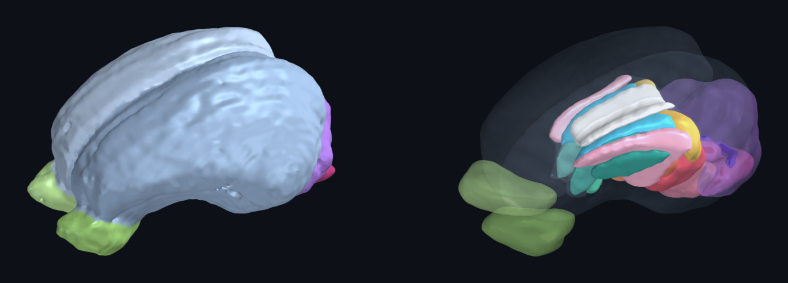

[](https://pigmri.illinois.edu/neuroimaging-resources)
[](https://pigmri.illinois.edu/neuroimaging-resources)
[](#at-a-glance)
[](#labeled-regions)
[](LICENSE)

[](https://doi.org/10.1016/j.jneumeth.2021.109107)
[](https://doi.org/10.1016/j.jneumeth.2021.109107)
[](https://pubmed.ncbi.nlm.nih.gov/33675840/)
[](https://creativecommons.org/licenses/by-nc-nd/4.0/)
[](https://nifti.nimh.nih.gov/nifti-1)
[](#)
[](https://pigmri.illinois.edu/)
[](CITATION.cff)

[Overview](#overview) · [At a glance](#at-a-glance) · [Gallery](#gallery) · [Paper figures](#from-the-paper) · [Contents](#contents) · [Regions](#labeled-regions) · [Usage](#usage) · [Versions](#version-history) · [Citation](#citation) · [Contact](#authors-and-contact) · [License](#license)

</div>

---

## Overview

This repository holds version 2.1 of the magnetic resonance imaging (MRI) brain atlases for the domestic pig at 4 and 12 weeks of age. The atlases were built by the Piglet Nutrition & Cognition Laboratory (Department of Animal Sciences) together with the Biomedical Imaging Center at the Beckman Institute for Advanced Science and Technology, University of Illinois Urbana-Champaign, from scans of 20 artificially reared male pigs at 4 weeks of age and 13 sow-reared male pigs at 12 weeks of age (Fil et al., 2021). Each age provides an averaged T1-weighted template, binary masks for 29 regions of interest at three probability thresholds, combined label maps, tissue probability maps for gray matter, white matter, cerebral spinal fluid (CSF) and non-brain tissue, and a fractional anisotropy (FA) template for tract-based spatial statistics (TBSS).

Version 2.1 was released on 21 July 2023, after the original article was published, and is the newest release for both ages on the [Pig Imaging Group website](https://pigmri.illinois.edu/neuroimaging-resources). The files in `atlas/` are unpacked unchanged from the official downloads. In this regard, the repository adds documentation, checksums, and rendered previews, but no modified imaging data. The two original archives (about 19 MB together, versus 2.2 GB unpacked) are attached to the [v2.1 release](https://github.com/Nutrition-Health-Neuroscience-DilgerLab/pig-brain-atlas-v2.1/releases/tag/v2.1) for anyone who prefers a single download to a clone.

## At a glance

| | 4-week-old atlas | 12-week-old atlas |
|---|---|---|
| Matrix (voxels) | 160 × 200 × 160 | 78 × 120 × 78 |
| Voxel size | 0.5 mm isotropic | 1.0 mm isotropic |
| Labeled regions | 29 | 29 |
| ROI thresholds | 0, 25, 50% | 0, 25, 50% |
| Tissue classes | gray matter, white matter, CSF, not-brain | gray matter, white matter, CSF, not-brain |
| FA template | yes | yes |
| Template threshold applied | 200 | 600 |
| Uncompressed size | 1.97 GB | 0.28 GB |
| File format | NIfTI-1 (`.nii`), float32, qform and sform set | NIfTI-1 (`.nii`), float32, qform and sform set |

Within each age all 96 images (template, region masks, combined maps, tissue maps and FA template) share one voxel grid, so every region mask applies directly to any image registered to the template of that age.

## Gallery

### 3D renders

<table>
<tr>
<td width="42%">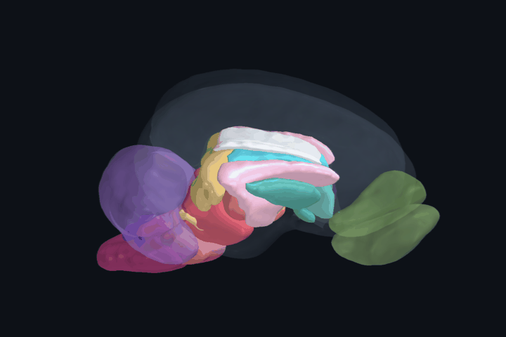</td>
<td>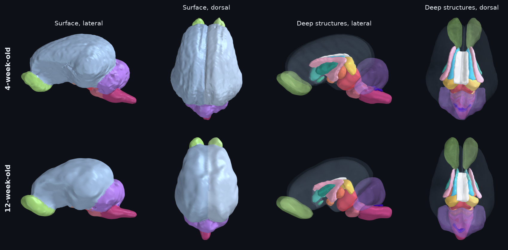</td>
</tr>
<tr>
<td align="center"><sub>4-week-old atlas, deep structures with a translucent cortex</sub></td>
<td align="center"><sub>Outer surface colored by nearest region, and deep structures, for both ages</sub></td>
</tr>
</table>

The outer surface is an isosurface of the averaged template colored by the nearest atlas label, which keeps the gyral pattern of the template. The deep-structure renders are smoothed surfaces of each region in the combined label map at the 50% threshold, with the cortex drawn as glass and the cerebellum and olfactory bulbs semi-transparent.

<details>
<summary><b>Full-resolution 3D renders</b></summary>

| | Surface | Deep structures |
|---|---|---|
| 4 weeks | 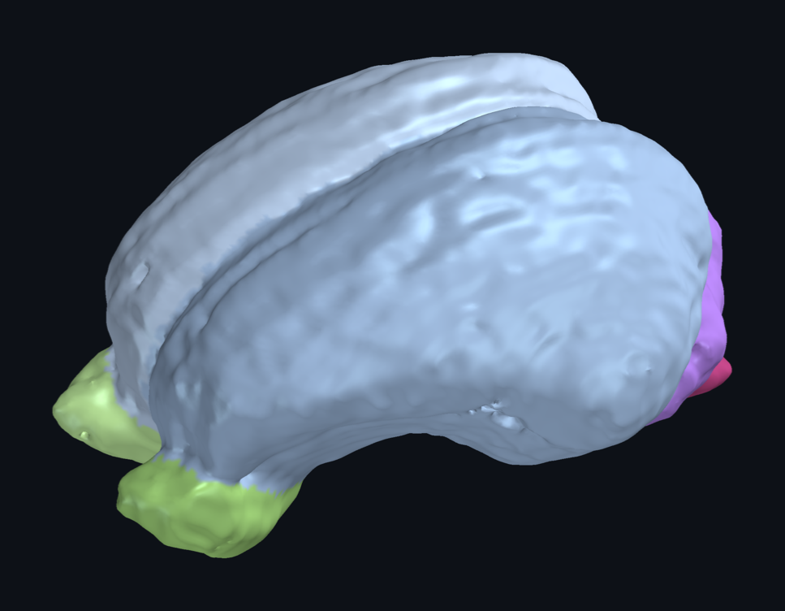 | 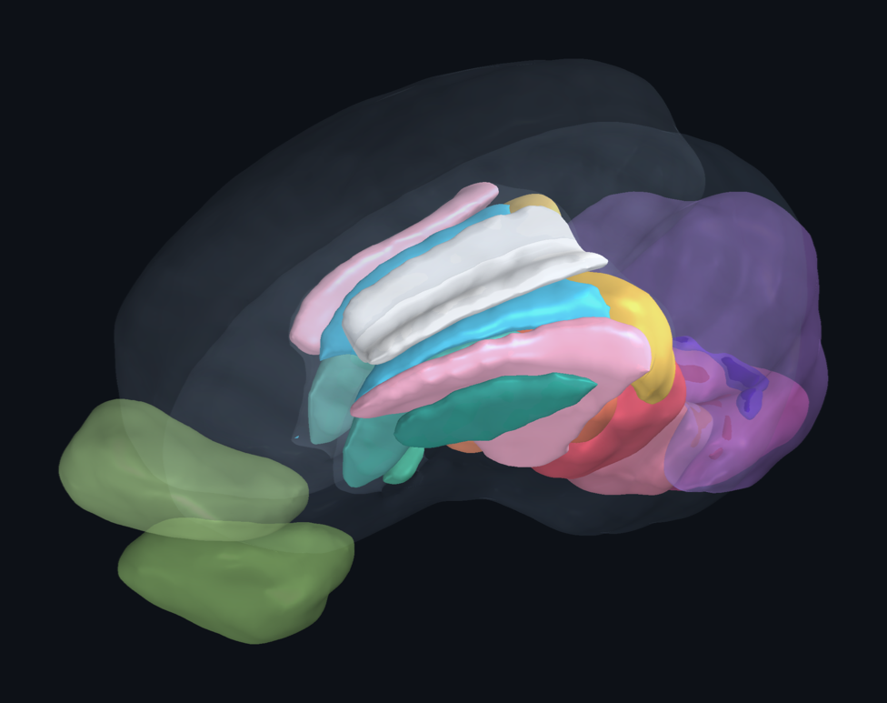 |
| 12 weeks | 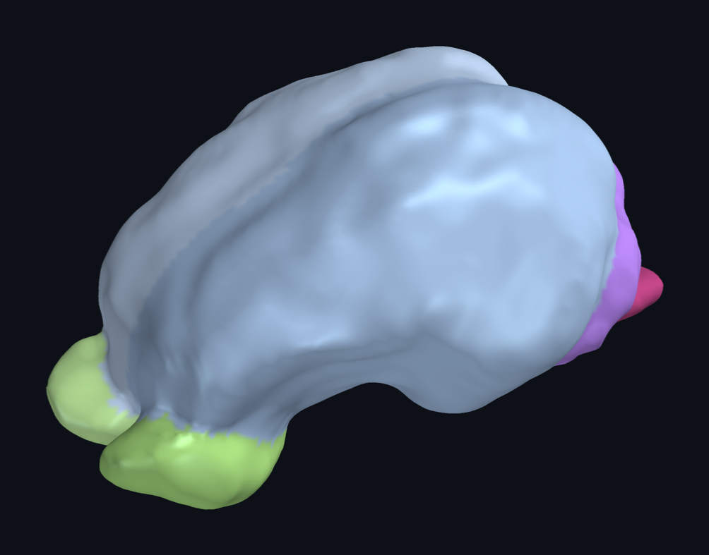 | 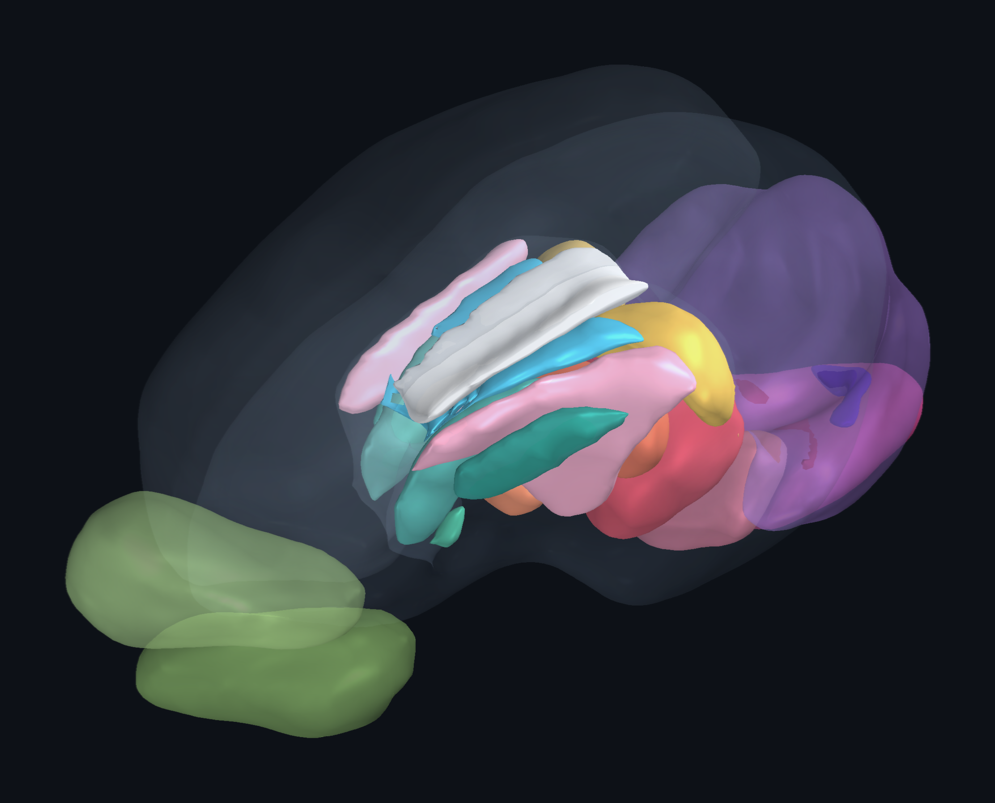 |

</details>

### Orthogonal slices

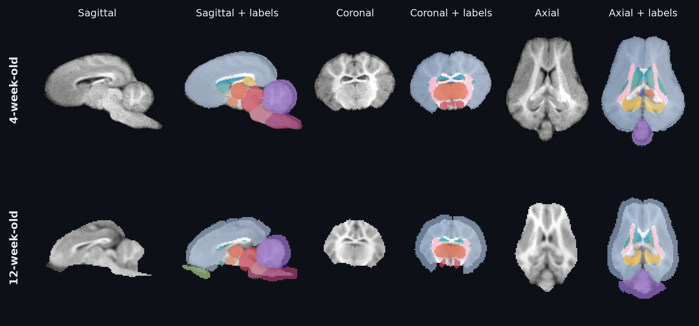

### Coronal series

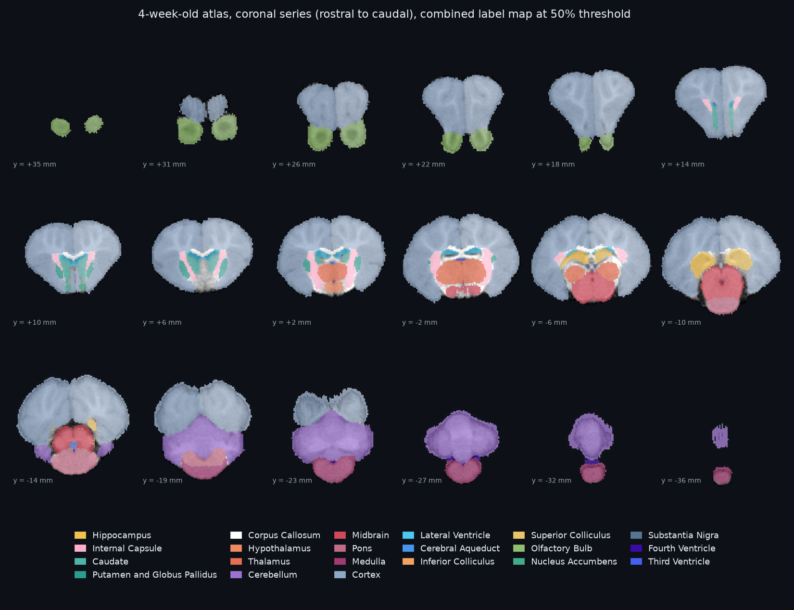

<details>
<summary><b>12-week-old coronal series</b></summary>

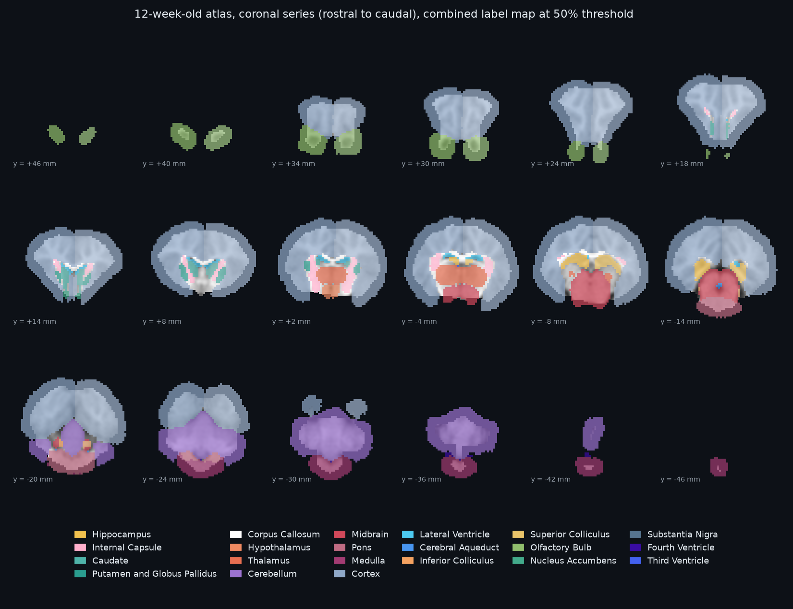

The label maps of the 12-week-old atlas extend slightly beyond the thresholded template; that rim appears as a darker band around the cortex.

</details>

### Tissue probability maps and FA template

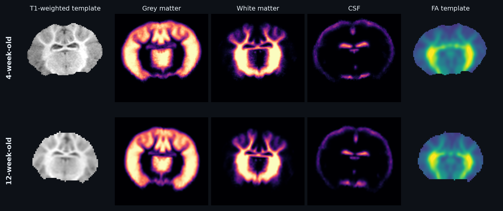

## From the paper

The atlases, the image processing pipelines and normative brain measures for both ages are described in [Fil et al. (2021)](https://doi.org/10.1016/j.jneumeth.2021.109107). The figures below are reproduced without modification from that article (© 2021 The Author(s), published by Elsevier B.V. under [CC BY-NC-ND 4.0](https://creativecommons.org/licenses/by-nc-nd/4.0/)). They show atlas version 2.0, with 26 regions; version 2.1 adds the nucleus accumbens, putamen, substantia nigra and third ventricle. The short captions here are descriptions of each figure, so please see the article for the full captions.

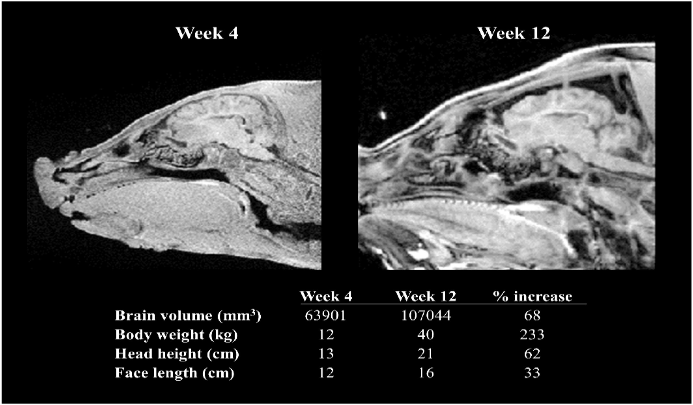

<sub>**Fil et al. (2021), Fig. 1.** Head and body dimensions of the young (4-week) and adolescent (12-week) pig. Sagittal T1-weighted images of the head at both ages, shown in the voxel space of the young pig, with brain volume, body weight, head height and face length and the percent increase from 4 to 12 weeks.</sub>

<table>
<tr>
<td width="50%">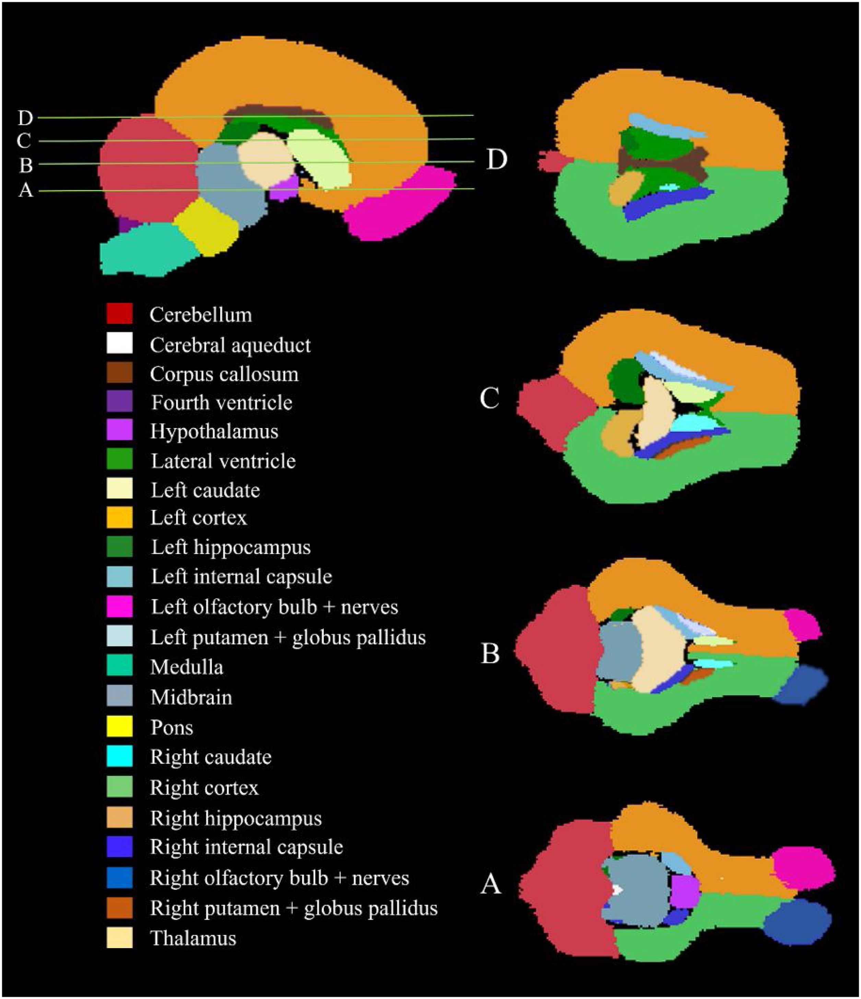</td>
<td width="50%">
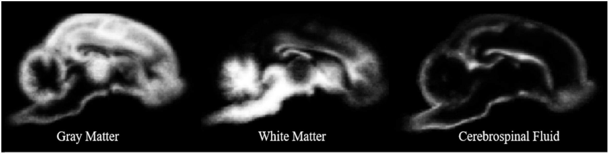
<br><sub><b>Fig. 2.</b> Sagittal slices of the gray matter, white matter and CSF tissue probability maps.</sub>
<br><br>
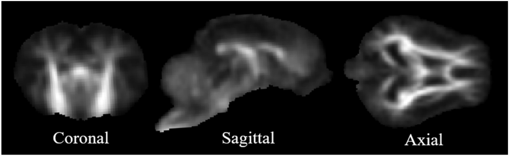
<br><sub><b>Fig. 6.</b> Fractional anisotropy template of the 4-week atlas in coronal, sagittal and axial views, in atlas space.</sub>
</td>
</tr>
<tr>
<td colspan="2"><sub><b>Fig. 5.</b> Regions of interest of the 4-week atlas (version 2.0) as a probability map at the 25% threshold, in a sagittal view and at four axial levels (A to D). The superior and inferior colliculi are not shown because they overlap the midbrain.</sub></td>
</tr>
</table>

<details>
<summary><b>Atlas construction pipelines (Fig. 3 and Fig. 4)</b></summary>

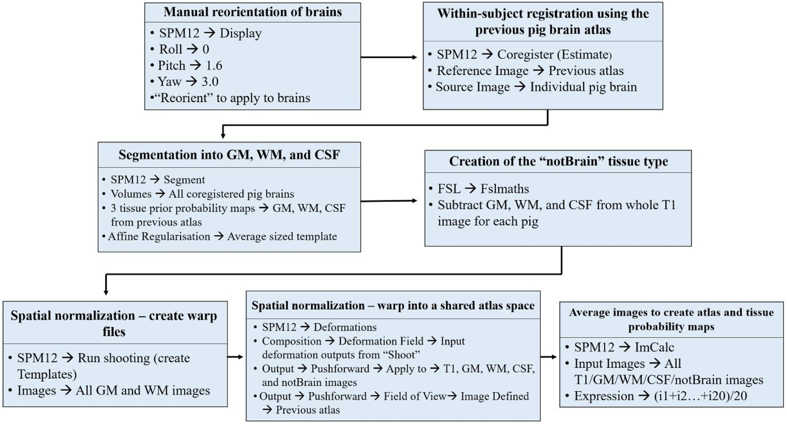

<sub>**Fig. 3.** Workflow for the young pig (4-week) atlas: 20 brains registered to the previous atlas, segmented and normalized with SPM12, then averaged.</sub>

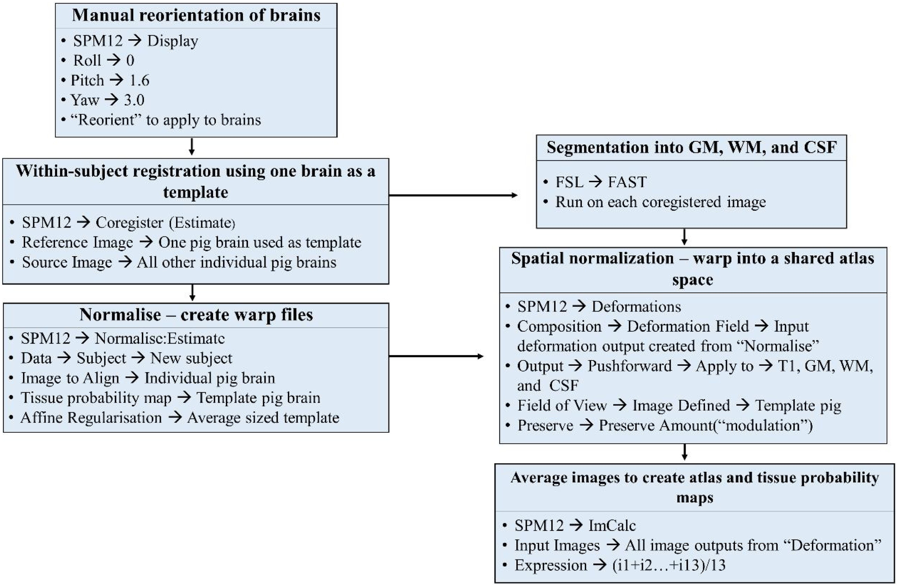

<sub>**Fig. 4.** Workflow for the adolescent pig (12-week) atlas: 13 brains registered to one brain used as the template, segmented with FSL FAST, normalized with SPM12, then averaged.</sub>

</details>

## Contents

```
.
├── atlas/
│   ├── v2.1_4wk_Atlas/
│   │   ├── Pig_Brain_Atlas_4wk.nii                  averaged T1-weighted template
│   │   ├── Pig_FA_Standard_4wk.nii                  FA template for TBSS
│   │   ├── Combined_Maps_4wk/
│   │   │   ├── Combined_thr{0,25,50}_4wk.nii        all regions in one label image
│   │   │   └── ROI_Labels_4wk.xlsx                  label number for each region
│   │   ├── Regions_of_Interest_4wk/
│   │   │   └── ROI_thr{0,25,50}/<Region>_thr*.nii   one binary mask per region
│   │   ├── Tissue_Probability_Maps_4wk/
│   │   │   └── {Gray_Matter,White_Matter,Cerebrospinal_Fluid,Not_Brain}_4wk.nii
│   │   └── Pig_MRI_Atlas_V2.1_ROI_and_Combined_Voxel_Volume_Comparison.xlsx
│   └── v2.1_12wk_Atlas/                             same layout, "_12wk" suffix
│       └── Tissue_Probability_Maps/                 (folder has no age suffix)
├── docs/figures/                                    rendered previews used in this README
│   └── paper/                                       figures from Fil et al. (2021), CC BY-NC-ND 4.0
├── downloads/SHA256SUMS                             checksums of the original archives
├── ATLAS_SHA256SUMS                                 checksum of every extracted file
├── CITATION.cff
├── LICENSE                                          CC BY-NC-ND 4.0
└── README.md
```

**Region masks.** Each region is provided as a binary mask at three probability thresholds: 0% (`ROI_thr0`, any non-zero probability), 25% (`ROI_thr25`) and 50% (`ROI_thr50`). Higher thresholds give smaller, more conservative regions.

**Combined maps.** The combined maps hold every region in one image, with the integer value of each voxel equal to the label number in `ROI_Labels_*.xlsx`. Overlaps between regions were resolved with a priority list using a maximum likelihood approach. As such, some lower-priority regions have few or no voxels in the combined maps (for example, the substantia nigra in the 12-week combined map at 50%), and the voxel volume workbook compares each separate mask with its representation in the combined maps. The workbook is identical in both age folders.

**Tissue probability maps.** The gray matter, white matter and CSF maps hold probabilities between 0 and 1, and the not-brain map is binary.

## Labeled regions

The table lists each label number and the volume of its separate region mask at the 50% threshold, taken from `Pig_MRI_Atlas_V2.1_ROI_and_Combined_Voxel_Volume_Comparison.xlsx`. Colors match the figures above.

| Label | Region | 4-week volume (mm³) | 12-week volume (mm³) |
|---:|---|---:|---:|
| 1 |  Left Hippocampus | 461.9 | 732 |
| 2 |  Right Hippocampus | 475.2 | 735 |
| 3 |  Left Internal Capsule | 634.5 | 908 |
| 4 |  Right Internal Capsule | 698.4 | 939 |
| 5 |  Left Caudate | 342.2 | 426 |
| 6 |  Right Caudate | 333.6 | 407 |
| 7 |  Left Putamen and Globus Pallidus | 197.6 | 294 |
| 8 |  Right Putamen and Globus Pallidus | 208.9 | 294 |
| 9 |  Corpus Callosum | 410.6 | 530 |
| 10 |  Hypothalamus | 136.4 | 279 |
| 11 |  Thalamus | 1,530.1 | 2,087 |
| 12 |  Cerebellum | 7,579.6 | 15,195 |
| 13 |  Midbrain | 2,452.0 | 4,059 |
| 14 |  Pons | 1,592.0 | 2,743 |
| 15 |  Medulla | 2,059.2 | 4,305 |
| 16 |  Left Cortex | 20,802.0 | 37,341 |
| 17 |  Right Cortex | 19,874.6 | 36,895 |
| 18 |  Lateral Ventricle | 527.0 | 605 |
| 19 |  Cerebral Aqueduct | 48.1 | 60 |
| 20 |  Left Inferior Colliculus | 124.8 | 198 |
| 21 |  Right Inferior Colliculus | 125.0 | 182 |
| 22 |  Left Superior Colliculus | 215.4 | 321 |
| 23 |  Right Superior Colliculus | 218.5 | 330 |
| 24 |  Left Olfactory Bulb | 1,360.1 | 3,092 |
| 25 |  Right Olfactory Bulb | 1,388.8 | 2,956 |
| 26 |  Nucleus Accumbens | 58.8 | 88 |
| 27 |  Substantia Nigra | 45.2 | 85 |
| 28 |  Fourth Ventricle | 125.0 | 211 |
| 29 |  Third Ventricle | 41.9 | 27 |

## Usage

The atlases work with standard neuroimaging software such as FSL, SPM, ANTs and nibabel. A typical workflow registers each subject to the template of the matching age, then uses the inverse transform to bring the region masks or tissue maps into subject space, or extracts values from subject images already warped to the template.

**Region volume from a mask (FSL).**

```bash
fslstats atlas/v2.1_4wk_Atlas/Regions_of_Interest_4wk/ROI_thr50/Left_Hippocampus_thr50.nii -V
```

**Mean value of a template-space image within every region (Python).**

```python
import nibabel as nib
import numpy as np

age = "4wk"
labels = nib.load(f"atlas/v2.1_{age}_Atlas/Combined_Maps_{age}/Combined_thr50_{age}.nii")
fa = nib.load(f"atlas/v2.1_{age}_Atlas/Pig_FA_Standard_{age}.nii")  # or your own image in template space

lab = np.rint(labels.get_fdata()).astype(int)
img = fa.get_fdata()
for k in range(1, 30):
    mask = lab == k
    if mask.any():
        print(k, round(float(img[mask].mean()), 3))
```

**Integrity check.** To confirm that the atlas files are unchanged, run the following from the `atlas/` folder:

```bash
shasum -a 256 -c ../ATLAS_SHA256SUMS
```

## Version history

| Version | Released | Ages | Regions | Notes |
|---|---|---|---|---|
| **2.1** | 2023-07-21 | 4 wk, 12 wk | 29 | Current release, issued after the 2021 article. Adds the nucleus accumbens, putamen, substantia nigra and third ventricle; corrects inconsistent values and orientation errors across the three ROI thresholds; introduces the priority list for the combined maps; makes the not-brain map binary; adds an FA template for both ages; thresholds the templates (200 at 4 weeks, 600 at 12 weeks) and crops and centers the 12-week template and masks. |
| [2.0](https://github.com/Nutrition-Health-Neuroscience-DilgerLab/pig-brain-atlas-v2.0) | 2021-04-01 | 4 wk, 12 wk | 26 | Updated 4-week atlas and the first 12-week atlas, described in Fil et al. (2021). |
| [1.2](https://github.com/Nutrition-Health-Neuroscience-DilgerLab/pig-brain-atlas-v1.2) | 2016-12-12 | 4 wk | 19 | Original 4-week atlas (Conrad et al., 2014) with smoothed tissue probability maps. Released under CC0. |

Earlier versions have their own repositories: [pig-brain-atlas-v2.0](https://github.com/Nutrition-Health-Neuroscience-DilgerLab/pig-brain-atlas-v2.0) and [pig-brain-atlas-v1.2](https://github.com/Nutrition-Health-Neuroscience-DilgerLab/pig-brain-atlas-v1.2). All versions are listed on the [Pig Imaging Group website](https://pigmri.illinois.edu/neuroimaging-resources).

## Citation

Please cite the article that describes the 4-week and 12-week atlases when using these files:

> Fil, J. E., Joung, S., Zimmerman, B. J., Sutton, B. P., & Dilger, R. N. (2021). High-resolution magnetic resonance imaging-based atlases for the young and adolescent domesticated pig (*Sus scrofa*). *Journal of Neuroscience Methods*, *354*, 109107. https://doi.org/10.1016/j.jneumeth.2021.109107

```bibtex
@article{fil2021pigatlas,
  title   = {High-resolution magnetic resonance imaging-based atlases for the young and adolescent domesticated pig (Sus scrofa)},
  author  = {Fil, Joanne E. and Joung, Sangyun and Zimmerman, Benjamin J. and Sutton, Bradley P. and Dilger, Ryan N.},
  journal = {Journal of Neuroscience Methods},
  volume  = {354},
  pages   = {109107},
  year    = {2021},
  doi     = {10.1016/j.jneumeth.2021.109107}
}
```

A machine-readable citation is provided in [`CITATION.cff`](CITATION.cff).

**Related resources.** [PigBET](https://github.com/Nutrition-Health-Neuroscience-DilgerLab/PigBET) is a deep learning tool for skull stripping and brain extraction in pig MRI, also distributed through the Pig Imaging Group website.

## Authors and contact

**Atlas authors (Fil et al., 2021):** Joanne E. Fil, Sangyun Joung, Benjamin J. Zimmerman, Bradley P. Sutton and Ryan N. Dilger.

| | |
|---|---|
| **Ryan N. Dilger** | Department of Animal Sciences, Piglet Nutrition & Cognition Laboratory, University of Illinois Urbana-Champaign · [rdilger2@illinois.edu](mailto:rdilger2@illinois.edu) · [lab website](https://publish.illinois.edu/rdilger2/) |
| **Bradley P. Sutton** | Department of Bioengineering and Biomedical Imaging Center, Beckman Institute, University of Illinois Urbana-Champaign · [bsutton@illinois.edu](mailto:bsutton@illinois.edu) · [lab website](http://mrfil.bioen.illinois.edu/) |

Questions about the atlases can be sent to Ryan N. Dilger.

## License

The atlas files are licensed under the [Creative Commons Attribution-NonCommercial-NoDerivatives 4.0 International License](https://creativecommons.org/licenses/by-nc-nd/4.0/) (CC BY-NC-ND 4.0); the full text is in [`LICENSE`](LICENSE). You may use and share them for noncommercial purposes, provided you cite Fil et al. (2021) and do not distribute modified versions of the atlas files.

Commercial use is not covered by this license. To discuss a commercial license, contact Ryan N. Dilger ([rdilger2@illinois.edu](mailto:rdilger2@illinois.edu)).

The six figures in `docs/figures/paper/` are © 2021 The Author(s), published by Elsevier B.V., and are reproduced without modification under [CC BY-NC-ND 4.0](https://creativecommons.org/licenses/by-nc-nd/4.0/) from Fil et al. (2021). All other figures in `docs/figures/` were rendered from the atlas files.
